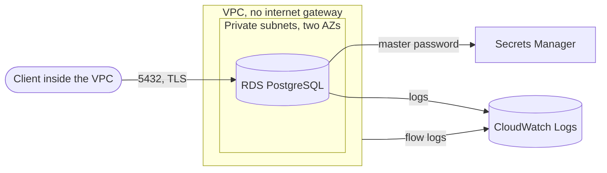

# AWS Managed PostgreSQL (RDS)

A single RDS PostgreSQL instance in private subnets.

OpenTofu demo template. Standalone, no dependency on other repos. Compatible with Terraform.

## Architecture



- VPC with two private subnets in two AZs, no internet gateway
- Security group: port 5432 only from inside the VPC
- RDS PostgreSQL (single instance, Multi-AZ optional) with a parameter group
- Master password generated and managed by RDS in Secrets Manager
- Database logs exported to CloudWatch, enhanced monitoring, VPC flow logs

## Security

- Not publicly accessible, private subnets only, default security group without rules
- Storage encryption, SSL enforced (`rds.force_ssl = 1`)
- Master password managed by RDS in Secrets Manager. It is never in the code or the state
- IAM database authentication enabled
- Automated backups (at least 1 day, default 7), minor version upgrades on
- Connection and disconnection logging, logs exported to CloudWatch, enhanced monitoring, VPC flow logs

Accepted checkov findings (documented inline in the code):

| Check | Reason |
|---|---|
| CKV_AWS_157 | Multi-AZ is configurable (`advanced_settings.multi_az`), off by default for cost |
| CKV_AWS_293 | Deletion protection is configurable, off by default so the demo can be destroyed |
| CKV_AWS_353 | Performance Insights is not available on the smallest instance classes |
| CKV_AWS_338, CKV_AWS_158 | Log retention is configurable, AWS-managed encryption for logs |
| CKV_AWS_394 | Only the first two zones are used |

## Usage

Configure AWS credentials, for example with `aws configure sso` or environment variables.

```bash
cp terraform.tfvars.example terraform.tfvars
tofu init
tofu plan
tofu apply
```

## Access

The database is reachable only from inside the VPC. Clients (for example an EC2 instance or a Lambda function) must run in this VPC. Read the master password from Secrets Manager:

```bash
aws secretsmanager get-secret-value --secret-id <master_user_secret_arn> --query SecretString --output text
```


## Inputs

| Name | Description | Default |
|---|---|---|
| `name_prefix` | Prefix for all resource names | `"demo"` |
| `region` | AWS region | `"eu-central-1"` |
| `advanced_settings` | Object with the settings below, all optional | `{}` |

`advanced_settings` attributes (shown as "Advanced Settings" in the StackGuardian form):

| Name | Description | Default |
|---|---|---|
| `vpc_cidr` | CIDR block of the VPC | `"10.0.0.0/16"` |
| `engine_version` | PostgreSQL major version | `"17"` |
| `instance_class` | RDS instance class | `"db.t4g.micro"` |
| `allocated_storage` | Storage in GiB (autoscaling up to twice the size) | `20` |
| `database_name` | Initial database | `"app"` |
| `master_username` | Master user | `"dbadmin"` |
| `multi_az` | Standby in a second AZ | `false` |
| `backup_retention_days` | Days to keep automated backups, at least 1 | `7` |
| `deletion_protection` | Protect the instance from deletion | `false` |
| `skip_final_snapshot` | Skip the final snapshot on destroy | `true` |
| `log_retention_days` | Log retention in CloudWatch | `90` |
| `tags` | Additional tags for all resources | `{}` |

## Outputs

| Name | Description |
|---|---|
| `endpoint` | Host name of the database |
| `port` | Port |
| `database_name` | Initial database |
| `master_username` | Master user |
| `master_user_secret_arn` | Secrets Manager secret with the master password |
| `vpc_id` | VPC ID |
| `private_subnet_ids` | IDs of the private subnets |

## Cost

The DB instance and its storage are billed hourly, also when idle. Secrets Manager bills per secret per month. Creating the instance takes about 5 to 10 minutes.

**Destroy after the demo:**

```bash
tofu destroy
```

## Tests

The GitLab pipeline (`.gitlab-ci.yml`) lints every push. Merge requests into `development` or `main` also run
validation, the checkov scan and the unit tests. A tag runs all of these plus the integration tests, which deploy
real resources and destroy them again, and then creates a release. Integration tests run only when the CI/CD variable `AWS_ROLE_ARN` is set: an IAM role trusted for GitLab OIDC with the audience `sts.amazonaws.com`. `AWS_REGION` is optional.

In GitLab, the `unit-tests` job also publishes its results as a JUnit test report, which you find in the **Tests** tab of the pipeline and of the merge request. The script `ci/tofu-json-to-junit.py` converts the output of `tofu test -json` to JUnit XML.

The GitHub Actions workflow (`.github/workflows/ci.yml`) runs the same jobs: every push, pull requests into `development` or `main`, and tags. Set `AWS_ROLE_ARN` (and optionally `AWS_REGION`) as repository variables; the IAM role then needs a trust for GitHub OIDC (`token.actions.githubusercontent.com`).

```bash
tofu test -test-directory=tests/unit
```

Test cases: [tests/README.md](tests/README.md)

## Development

```bash
pre-commit install
pre-commit run --all-files
```
